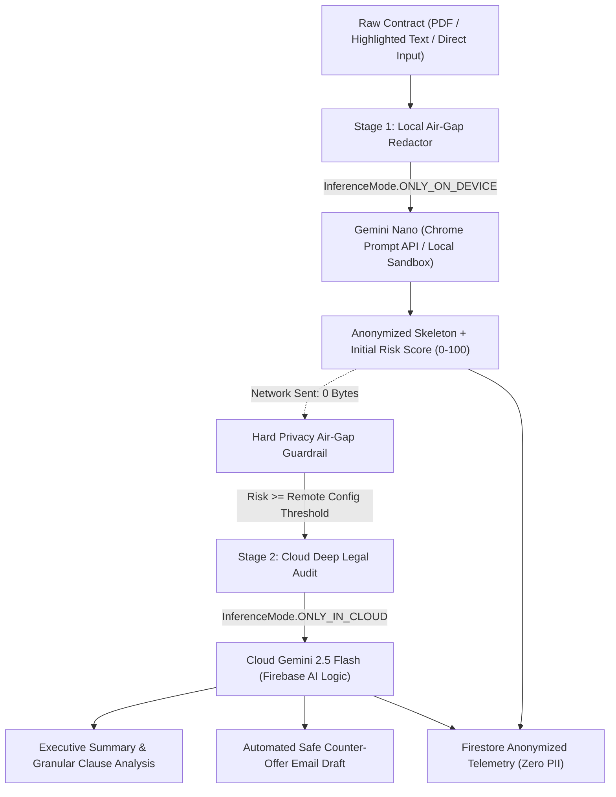

# ClauseGuard Hybrid (#BuildHybridAI 2026)

> **Zero-PII Privacy Air-Gap Contract Firewall & Fraud Detector** powered by Firebase AI Logic, on-device Gemini Nano, Cloud Gemini 2.5 Flash, and an interactive 3D Sea Ring threat visualization engine.

ClauseGuard Hybrid protects job seekers, freelancers, and startup founders from predatory legal traps, oppressive non-competes, and advance-fee employment scams without ever exposing sensitive personally identifiable information (PII) to cloud servers or remote networks.

---

## 🏗️ Architecture: Hybrid Privacy Air-Gap

The central principle of ClauseGuard is **Never transmit unredacted personal information over the network**. ClauseGuard routes intelligence dynamically between edge compute (on-device) and cloud models via **Firebase AI Logic (`firebase/ai`)**:



### 1. Stage 1: Local Air-Gap Redaction (`InferenceMode.ONLY_ON_DEVICE`)
- **Engine**: On-device Gemini Nano (via Chrome Prompt API `window.ai` or sandboxed edge parser).
- **Network Footprint**: **0 Bytes (Hard Air-Gap)**.
- **Capabilities**:
  - Detects and redacts candidate names (`[REDACTED_NAME]`), contacts (`[REDACTED_CONTACT]`), salaries (`[REDACTED_SALARY]`), identification numbers (`[REDACTED_ID]`), and locations (`[REDACTED_ADDRESS]`).
  - Computes immediate risk scores (0–100) and detects red flags (advance-fee cashier check scams, 24-month worldwide non-competes, all-encompassing IP assignment traps).
  - Emits real-time edge telemetry with sub-100ms latency.

### 2. Privacy Air-Gap Guardrail
- Hard enforcement validation layer executed before any network transmission:
  - Scans outbound payloads for raw emails, phone numbers, tax IDs, or unredacted personal tokens.
  - Automatically aborts network requests if unredacted private data is detected.

### 3. Stage 2: Cloud Deep Legal Audit (`InferenceMode.ONLY_IN_CLOUD`)
- **Engine**: Cloud `gemini-2.5-flash` via Firebase AI Logic.
- **Payload**: Strictly sanitized, PII-free contract skeleton.
- **Capabilities**:
  - Detailed clause-by-clause breakdown across severity tiers (`LOW`, `MEDIUM`, `HIGH`, `CRITICAL`).
  - Scrutinizes document legitimacy (e.g. counterfeit check schemes vs. predatory freelance clauses).
  - Drafts legally grounded, ready-to-send counter-offer negotiation emails.

### 4. Firebase Remote Config & Anonymized Firestore Telemetry
- **Remote Config**: Dynamically adjusts runtime parameters (`routing_mode`, `cloud_escalation_threshold`) without client redeployment.
- **Firestore Stream**: Logs zero-PII scan telemetry (`riskScore`, `detectedFlags`, `engineUsed`, `timestamp`) for public security auditing and threat intelligence.

---

## 🌊 Visual Experience & Atmospheric Engine

ClauseGuard Hybrid pairs state-of-the-art privacy architecture with an immersive editorial design and 3D visualization system inspired by modern luxury editorial layouts:

### 1. Opening Sequence & FLIP Wordmark Transition
- **Masked Letter Flight**: The *"Clause."* wordmark rises from overflow-hidden masks with staggered cubic-bezier curves (`0.10s` to `0.58s`).
- **Real-Time Asset Odometer**: 3-digit vertical sliding counter synchronizes with the preloading of 16 cylindrical ring cards, complete with typewriter telemetry (`"INITIALIZING HYBRID ENGINE"`) and a 9-second failsafe.
- **FLIP Flight**: Upon completion, the loader wordmark seamlessly takes flight into the fixed top navigation bar.

### 2. 3D Cylindrical Threat Ring (`SeaRing3D.tsx`)
- **16-Slot Interactive Ring**: 16 categorized threat case studies mapped across three distinct worlds:
  - `build` (`#3AA8D0`): Startup & Equity Contracts (Liquidated damages, vesting cliffs, IP seizure).
  - `brand` (`#EEF4F6`): Offer Letter Scams (Fake equipment checks, wire fraud, identity theft).
  - `learn` (`#9ED8E4`): IP & Freelance Traps (Perpetual moral rights waivers, uncompensated non-competes).
- **Physical Cylinder Geometry**: Mathematical projection with dynamic expansion $e: 0 \to 1$, dynamic radius ($460 + 1340e$), tilt calculation, backface culling, and camera frustum clipping.
- **Spring-Damped Physics**: Rotational inertia (`stiffness: 150, damping: 27, mass: 1`), non-passive wheel scrolling, interactive drag gestures with click thresholds, and per-card 3D hover tilt.

### 3. Home Stage Editorial Typography & Preview Card (`HomeStage.tsx`)
- **3-Line Forced Headline**: Staggered word-rise animation linking to interactive contract worlds.
- **Pointer-Tracked Spring Card**: Fixed 260px preview card tracked via spring dynamics (`stiffness: 260, damping: 28, mass: 0.6`) featuring smart viewport-edge flip and 24px hysteresis.
- **Live Proof Stats**: Real-time indicators showing **0 KB** Cloud PII Leaked, live Firestore audit counters, and Gemini Nano sub-100ms latency.

### 4. Interactive Hybrid Audit Lab (`BuildAuditLab.tsx` / `#view-build`)
- **Sunlit Sea Atmosphere**: Atmospheric sea backdrop with drifting animated petals, motes, and pointer spring parallax.
- **Quick Fill-in-the-Blanks & Preset Pills**: Switch between *"Fake Remote Offer"*, *"Predatory Non-Compete"*, and *"Standard Offer"* presets with sliding active indicators.
- **Client-Side PDF Text Extractor**: In-browser vector PDF extraction via `pdfjs-dist` with zero server uploads.
- **Magnetic Buttons & Ghost Actions**: Magnetic cursor interaction (`0.3 * dx, 0.4 * dy`), one-click skeleton copying with flash feedback, and live Remote Config polling.
- **Live Privacy Diff**: Side-by-side comparison of the raw document versus the anonymized skeleton highlighting redaction badges (`[REDACTED_NAME]`, `[REDACTED_SALARY]`, etc.).
- **Live Firestore Telemetry Footer**: Real-time event ticker displaying anonymized audit records.

### 5. Responsiveness & Accessibility
- **Mobile First Fluid Units**: Proportional scaling (`--u`) on desktop transitioning to `calc(100vw / 390)` on mobile ($\le 820\text{px}$).
- **Scroll Lock Management**: Home view locks viewport scroll to prevent gesture interference; Audit Lab unlocks full natural scrolling.
- **Reduced Motion Support**: Complete `prefers-reduced-motion: reduce` compliance (skips loaders, disables video, freezes floating particles, renders static carousel).

---

## 📂 Project Structure

```
clauseguard-hybrid/
├── extension/                          # Chrome Extension Companion (Manifest V3)
│   ├── manifest.json                   # activeTab & scripting permissions
│   ├── popup.html                      # Extension popup UI
│   └── popup.js                        # Tab text extractor & local air-gap scanner
├── web/                                # Web Studio (React 19 + TypeScript + Vite)
│   ├── src/
│   │   ├── components/
│   │   │   ├── BuildAuditLab.tsx       # Stage 2 Hybrid Audit Lab & privacy diff
│   │   │   ├── HomeStage.tsx           # Editorial headline, stats & hover preview
│   │   │   └── SeaRing3D.tsx           # 3D cylindrical ring with physics & cards
│   │   ├── data/
│   │   │   ├── presets.ts              # Preset contract fixtures (Scam, Trap, Clean)
│   │   │   └── ringCards.ts            # 16-card dataset for the 3D Sea Ring
│   │   ├── hooks/
│   │   │   └── useClauseGuard.ts       # React state, routing, and Firestore hook
│   │   ├── lib/
│   │   │   ├── firebase.ts             # Firebase init (App Check, Auth, DB, RC, AI Logic)
│   │   │   ├── hybridRouter.ts         # Stage 1 on-device & Stage 2 cloud router
│   │   │   └── pdfExtractor.ts         # Client-side PDF text extractor (pdfjs-dist)
│   │   ├── styles/
│   │   │   └── seaRing.css             # Design tokens, keyframes, 3D transforms & responsive rules
│   │   ├── App.tsx                     # Top nav, view router (#home / #build), opening sequence
│   │   └── main.tsx
│   ├── index.html                      # Google Fonts, inline SVG favicon, dark mode
│   ├── .env.example                    # Firebase & App Check template
│   ├── package.json
│   └── vite.config.ts
├── LICENSE                             # Apache-2.0
└── README.md
```

---

## 🚀 Getting Started

### Prerequisites
- **Node.js 18+** and **npm**
- **Google Chrome** (Chrome 128+ with `chrome://flags/#prompt-api-for-gemini-nano` enabled for native Gemini Nano, or any browser for emulated local air-gap execution)
- A **Firebase Project** with Firestore, Anonymous Auth, Remote Config, and Firebase AI Logic enabled.

### 1. Web Application Setup

```bash
cd web
npm install
```

Create your `.env` file from `.env.example`:

```bash
cp .env.example .env
```

Configure your Firebase credentials in `web/.env`:
```env
VITE_FIREBASE_API_KEY=AIzaSy...
VITE_FIREBASE_AUTH_DOMAIN=your-app.firebaseapp.com
VITE_FIREBASE_PROJECT_ID=your-project-id
VITE_FIREBASE_STORAGE_BUCKET=your-app.appspot.com
VITE_FIREBASE_MESSAGING_SENDER_ID=...
VITE_FIREBASE_APP_ID=1:...
VITE_APPCHECK_DEBUG_TOKEN=true
```

Start the local development server:
```bash
npm run dev
```

Open [http://localhost:5173](http://localhost:5173).

### 2. Production Build & Linting

```bash
npm run build
npm run lint
```

---

## 🛡️ Firebase App Check Debug Token Setup

ClauseGuard Hybrid enforces Firebase App Check to secure backend services and prevent unauthorized API usage:

1. In `.env`, ensure `VITE_APPCHECK_DEBUG_TOKEN=true` is set.
2. Open the web app in Chrome and press `F12` to open DevTools (**Console** tab).
3. Look for the debug token emitted by Firebase App Check:
   ```
   [Firebase AppCheck] Debug token: "XXXXXXXX-XXXX-XXXX-XXXX-XXXXXXXXXXXX"
   ```
4. Copy the UUID token.
5. In the [Firebase Console](https://console.firebase.google.com/):
   - Go to **Build** > **App Check** > **Apps** tab.
   - Select your Web app, click `⋮` > **Manage debug tokens**.
   - Click **Add debug token**, paste the UUID, give it a label (e.g. `Local Dev`), and click **Save**.
6. All requests to Firestore and Firebase AI Logic are now authenticated.

---

## 🧩 Chrome Extension Companion Setup

The Chrome Extension allows instant contract and offer analysis directly from any browser tab (LinkedIn messages, Gmail offers, job boards):

1. Open Chrome and navigate to `chrome://extensions/`.
2. Toggle **Developer mode** (top-right corner) to **ON**.
3. Click **Load unpacked** (top-left).
4. Select the `CLAUSEGUARD-HYBRID/extension` directory.
5. Open any webpage with an employment agreement or message:
   - Click **"Grab Selected Text from Tab"** to import highlighted text.
   - Click **"Run Local Air-Gap Scan"** for instant on-device PII redaction and risk scoring.
   - Click **"Open ClauseGuard Web Studio"** to escalate the sanitized skeleton to Stage 2 Cloud Analysis.

---

## 🧪 Included Test Presets

The application includes three preconfigured contract presets in `web/src/data/presets.ts`:

1. **Fake Remote Tech Offer Scam**
   - High scam indicator: Advance-fee cashier check ($4,850) with urgent wire transfer to an unverified Telegram hardware vendor.
2. **Predatory Non-Compete & IP Trap Agreement**
   - Predatory clauses: 24-month worldwide non-compete, personal open-source and side-project IP seizure, and a $250,000 liquidated damages clause.
3. **Clean Standard Engineering Offer**
   - Balanced baseline: Fair employment covenants, explicit carve-out for prior personal inventions, no non-compete restraint, and direct company-provided equipment.

---

## 📄 License

Licensed under the [Apache License, Version 2.0](LICENSE).
