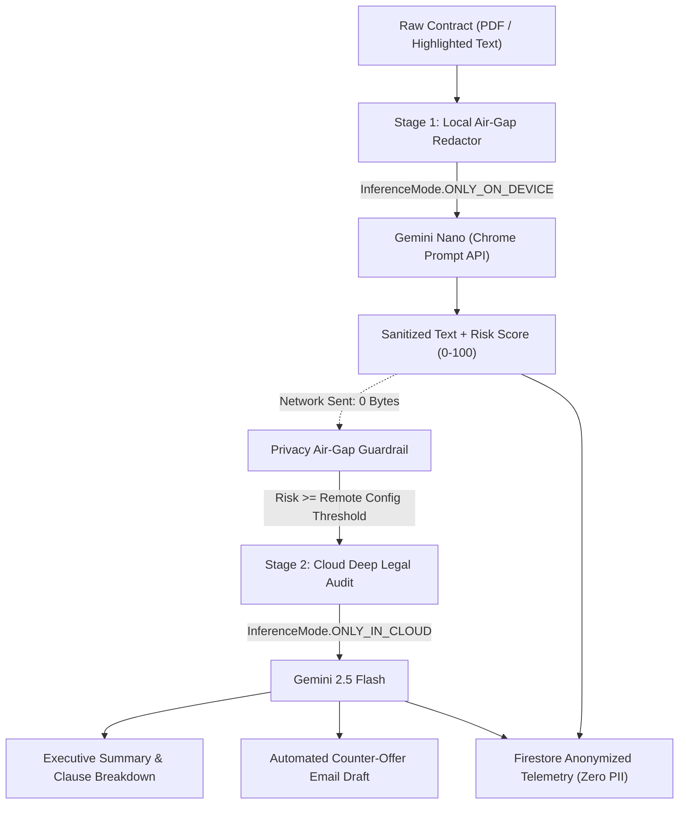

# ClauseGuard Hybrid (#BuildHybridAI 2026)

> **Zero-PII Privacy Air-Gap Contract Guard & Fraud Detector** powered by Firebase AI Logic, on-device Gemini Nano, and Gemini 2.5 Flash.

ClauseGuard Hybrid protects job seekers and contractors from predatory clauses, non-compete traps, and advance-fee employment scams without exposing sensitive personal identifiable information (PII) to cloud servers.

---

## 🏗️ Architecture: Hybrid Privacy Air-Gap

The core design principle is **Never transmit unredacted personal information over the network**. ClauseGuard routes intelligence between edge compute (on-device) and cloud models via **Firebase AI Logic (`firebase/ai`)**:



### 1. Stage 1: Local Air-Gap Redaction (`InferenceMode.ONLY_ON_DEVICE`)
- **Engine**: On-device Gemini Nano (via Chrome Prompt API / `window.ai` or client-side sandbox).
- **Network Footprint**: **0 Bytes**.
- **Actions**:
  - Automatically identifies and redacts candidate names (`[REDACTED_NAME]`), contacts (`[REDACTED_CONTACT]`), salaries (`[REDACTED_SALARY]`), identification numbers (`[REDACTED_ID]`), and physical addresses (`[REDACTED_ADDRESS]`).
  - Computes initial risk score (0–100) and detects high-risk flags (advance-fee checks, 24-month worldwide non-competes, all-encompassing IP grabs).
  - Telemetry: Returns exact latency and logs 0 bytes transmitted.

### 2. Air-Gap Privacy Guardrail
- Hard enforcement check before any network request:
  - Validates that the payload contains no raw unredacted emails, phone numbers, or Social Security / Tax ID numbers.
  - Throws an immediate exception if an unredacted document attempts cloud transmission.

### 3. Stage 2: Cloud Deep Legal Audit (`InferenceMode.ONLY_IN_CLOUD`)
- **Engine**: Cloud `gemini-2.5-flash` via Firebase AI Logic.
- **Payload**: Strictly anonymized, PII-free text.
- **Actions**:
  - Performs comprehensive contract audit with granular clause breakdown (`LOW`, `MEDIUM`, `HIGH`, `CRITICAL`).
  - Evaluates document authenticity (e.g. counterfeit advance-fee check scam vs. predatory terms vs. standard offer).
  - Generates ready-to-send professional counter-offer email draft to amend predatory language.

### 4. Firebase Remote Config & Anonymized Firestore Telemetry
- **Remote Config**: Dynamically adjusts `routing_mode` (`hybrid_airgap`, `hybrid_prefer_device`) and `cloud_escalation_threshold` (default `60`) in real time.
- **Firestore**: Stores anonymized scan telemetry (`riskScore`, `detectedFlags`, `engineUsed`, `timestamp`) for trend detection while guaranteeing that raw PII is never written to a database.

---

## 📂 Project Structure

```
clauseguard-hybrid/
├── extension/                       # Chrome Extension Companion (Manifest V3)
│   ├── manifest.json                # activeTab & scripting permissions
│   ├── popup.html                   # Extension popup UI
│   └── popup.js                     # Tab text grabber & on-device air-gap scanner
├── web/                             # Web Studio (React + TypeScript + Vite)
│   ├── src/
│   │   ├── data/
│   │   │   └── presets.ts           # Realistic contract presets (Scam, Trap, Clean)
│   │   ├── hooks/
│   │   │   └── useClauseGuard.ts    # React state, routing, and Firestore hook
│   │   ├── lib/
│   │   │   ├── firebase.ts          # Firebase init (App Check, Auth, DB, RC, AI Logic)
│   │   │   ├── hybridRouter.ts      # Stage 1 on-device & Stage 2 cloud router
│   │   │   └── pdfExtractor.ts      # Client-side PDF text extractor (pdfjs-dist)
│   │   ├── App.tsx                  # Minimal barebones test harness (ready for UI swap)
│   │   └── main.tsx
│   ├── .env.example                 # Firebase & App Check template
│   ├── package.json
│   └── vite.config.ts
├── LICENSE                          # Apache-2.0
└── README.md
```

---

## 🚀 Getting Started

### Prerequisites
- Node.js 18+ and npm
- Google Chrome (Chrome 128+ with `chrome://flags/#prompt-api-for-gemini-nano` enabled for native on-device Gemini Nano, or any browser for emulated local air-gap execution)
- A Firebase Project with **Firestore**, **Anonymous Auth**, **Remote Config**, and **Firebase AI Logic** enabled.

### 1. Web Application Setup

```bash
cd web
npm install
```

Create your `.env` file from the example:

```bash
cp .env.example .env
```

Configure your Firebase credentials in `.env`:
```env
VITE_FIREBASE_API_KEY=AIzaSy...
VITE_FIREBASE_AUTH_DOMAIN=your-app.firebaseapp.com
VITE_FIREBASE_PROJECT_ID=your-project-id
VITE_FIREBASE_STORAGE_BUCKET=your-app.appspot.com
VITE_FIREBASE_MESSAGING_SENDER_ID=...
VITE_FIREBASE_APP_ID=1:...
VITE_APPCHECK_DEBUG_TOKEN=true
```

Start the local development server:
```bash
npm run dev
```

Open [http://localhost:5173](http://localhost:5173).

---

## 🛡️ Firebase App Check Debug Token Setup

ClauseGuard Hybrid enforces Firebase App Check to secure backend services.

1. In `.env`, ensure `VITE_APPCHECK_DEBUG_TOKEN=true` is set.
2. Open the web app in Chrome and open Developer Tools (`F12` or `Ctrl+Shift+I` / `Cmd+Option+I`) to the **Console** tab.
3. Look for the debug token log emitted by Firebase App Check:
   ```
   [Firebase AppCheck] Debug token: "XXXXXXXX-XXXX-XXXX-XXXX-XXXXXXXXXXXX"
   ```
4. Copy the UUID token.
5. In the [Firebase Console](https://console.firebase.google.com/):
   - Go to **Build** > **App Check** > **Apps** tab.
   - Select your Web app, click the three-dots menu `⋮` and select **Manage debug tokens**.
   - Click **Add debug token**, paste your token, name it (e.g. `Localhost Dev`), and save.
6. Once registered, all requests to Firestore and Firebase AI Logic are verified.

---

## 🧩 Chrome Extension Companion Setup

The Chrome Extension allows instant contract and offer analysis directly from any browser tab (LinkedIn messages, Gmail offers, job boards):

1. Open Chrome and navigate to `chrome://extensions/`.
2. Toggle **Developer mode** (top-right corner) to **ON**.
3. Click **Load unpacked** (top-left).
4. Select the `clauseguard-hybrid/extension` directory.
5. Open any webpage, highlight text from an offer letter, and click the **ClauseGuard** extension icon:
   - Click **"Grab Selected Text from Tab"** to import highlighted text.
   - Click **"Run Local Air-Gap Scan"** to perform zero-network PII redaction and risk scoring on-device.
   - Click **"Open ClauseGuard Web Studio"** to jump into the full web app with escalation capabilities.

---

## 🧪 Included Test Presets

The application includes three realistic test documents in `web/src/data/presets.ts`:

1. **Fake Remote Tech Offer Scam**
   - High scam indicator: Advance-fee cashier check ($4,850) with urgent wire/Zelle transfer to an unverified Telegram hardware vendor.
2. **Predatory Non-Compete & IP Trap Agreement**
   - Predatory clauses: 24-month worldwide non-compete, personal open-source and side-project IP seizure, and a $250,000 liquidated damages clause.
3. **Clean Standard Engineering Offer**
   - Balanced baseline: Standard fair employment covenants, explicit carve-out for prior inventions, no non-compete restraint, and direct company-shipped equipment.

---

## 📄 License

Licensed under the [Apache License, Version 2.0](LICENSE).
